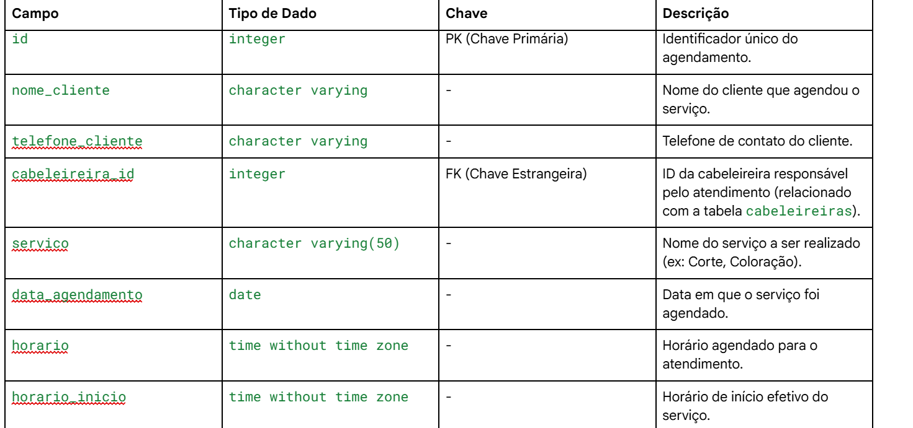
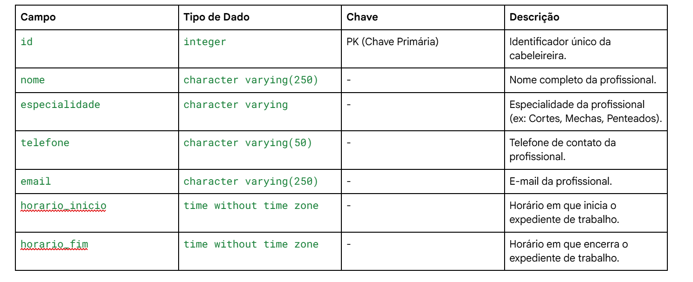
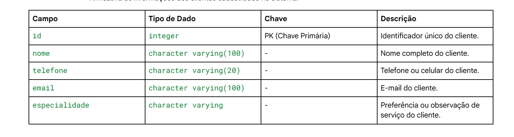
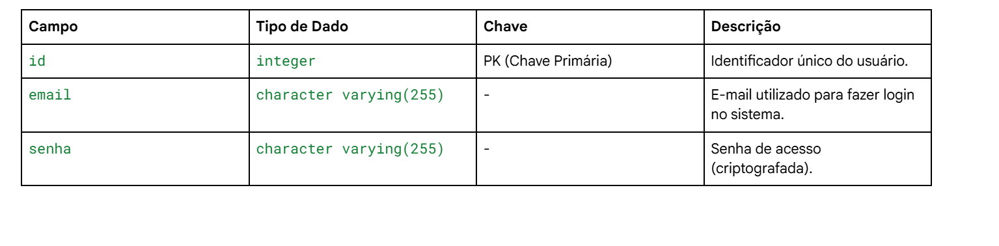
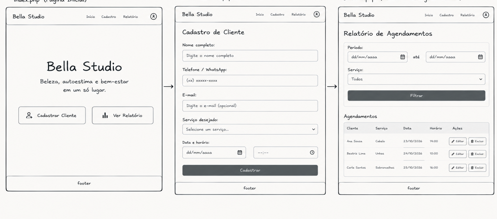

## studio bella
 Este sistema foi feito para organizar a rotina do salão de beleza de forma simples, ajudando a cadastrar e controlar os clientes, serviços e atendimentos, ficando mais facil para se agendar.

1. 2.1 Pré-Requisitos
- PHP (v7.4 ou superior) habilitado com a extensão pdo_pgsql.
- PostgreSQL instalado e em execução na porta padrão 5432.
- Git instalado na máquina.
- Navegador web atualizado.


#  Passo 1: Clonar repositório
Abra o terminal do seu sistema operacioal e clone o repositório executando:
- Clone este repositório
git clone https://github.com/GiovannaSangalli21/meu_cabelereiro.git

- Acesse a pasta do projeto
meu_cabelereiro 
# Passo 2: Configurar o Banco de Dados (Restore do Dump)
- O projeto inclui um arquivo de carga inicial chamado dump.sql. Siga as etapas para criar a base no PostgreSQL:

1 - Abra o terminal e conecte-se ao PostgreSQL com o usuário administrador (postgres):

 - psql -U postgres

2 - Dentro do ambiente do psql, execute os comandos abaixo para recriar a base de dados zerada (se a base já existir, ela será substituída):

```bash
DROP DATABASE IF EXISTS roupa;
CREATE USER roupa WITH PASSWORD 'roupa';
CREATE DATABASE roupa OWNER roupa;
\q
```
3 - Restaurar o banco de dados

Agora, restaure a estrutura e os dados do arquivo SQL na base recém-criada.

Se o arquivo dump.sql estiver na raiz do projeto::

# Restaura o banco de dados
- psql -U roupa -d roupa -f /database/dump.sql
´´´
Se o arquivo estiver dentro de uma pasta chamada database, utilize:

# Acesse a pasta db
- cd db

# Restaura o banco de dados
- psql -U roupa -d roupa -f /database/dump.sql

# Volte para a raiz do projeto
cd ..
## Passo 3: Configurar a Conexão no PHP
1 - Localize o arquivo de conexão presente em database/connect.php (ou na pasta equivalente do seu banco).

2 - Abra o arquivo em seu editor e verifique se os dados de acesso correspondem ao seu ambiente PostgreSQL:

PHP
$host = 'localhost';
$port = '5432';
$dbname = 'roupa';
$user = 'roupa';
$password = 'roupa';
Passo 4: Abrir o Site
Na pasta do projeto, ligue o servidor digitando:

Bash
php -S localhost:8000
Depois, abra o seu navegador e acesse:http://localhost:8000/

# 2. O que o Sistema Faz (Funções)
No sistema, você consegue fazer o controle completo (CRUD):

- Cadastrar Cliente (Adicionar): Colocar novos clientes no sistema digitando nome, telefone, especialidade e horários de trabalho.

- Ver Cliente(Listar): Ver uma lista com todos os clientes agendados.

- Ver Detalhes: Consultar os dados específicos de apenas um cliente.

- Editar cliente (Alterar): Mudar informações como telefone, especialidade ou horários ou oque ele pretende fazer de um cliente já cadastrado.

- Excluir cliente (Remover): Apagar o cadastro de um cliente do sistema.

- Histórico: Registrar os serviços realizados por cada cliente.

3. O que o Sistema Precisa Ter
O que ele faz (Requisitos Funcionais)

- Cadastrar, listar, editar e excluir: Todo o controle dos clientes do salão.

- Registrar atendimentos: Guardar o histórico do que cada cliente fez.

Como ele deve ser (Requisitos Não Funcionais)
- Fácil de usar
- Tela limpa que funciona bem tanto no computador quanto no celular.

- Funciona em qualquer lugar: Abre em navegadores modernos sem precisar instalar nada extra.

## tabela:
``` mermaid
---
Title: Studio Bella
---

erDiagram
    usuarios {
        int id PK "AUTO INCREMENT"
        VARCHAR(100) nome "NOT NULL"
        VARCHAR(100) email "NOT NULL"
        VARCHAR(255) senha "NOT NULL"
    }

    clientes {
        int id PK "AUTO INCREMENT"
        VARCHAR(100) nome "NOT NULL"
        VARCHAR(20) telefone "NOT NULL"
        VARCHAR(100) email "NOT NULL"
    }

    cabeleireiras {
        int id PK "AUTO INCREMENT"
        VARCHAR(100) nome "NOT NULL"
        VARCHAR(50) especialidade "NOT NULL"
    }

    agendamentos {
        int id PK "AUTO INCREMENT"
        int id_cliente FK "NOT NULL"
        int id_cabeleireira FK "NOT NULL"
        VARCHAR(50) servico "NOT NULL"
        DATE data_agendamento "NOT NULL"
        TIME horario_inicio "NOT NULL"
    }

    clientes ||--o{ agendamentos : "realiza"
    cabeleireiras ||--o{ agendamentos : "atende"
    usuarios ||--o{ clientes : "cadastra"
```````

4. Fluxo de funcionamento
1- O usuário ele ja entra na pagina principal.

2- No Painel Principal, ele tem acesso para fazer seu cadastro como cliente, com informções pessoais dele, e oque ele deseja fazer.

3- Ao se cadastrar , o registro é salvo e ele consegue editar o cadastro ou excluir.

### dicionario de dados:

## cabelereias:

## clientes:

## usuario:


## prototipagem:
